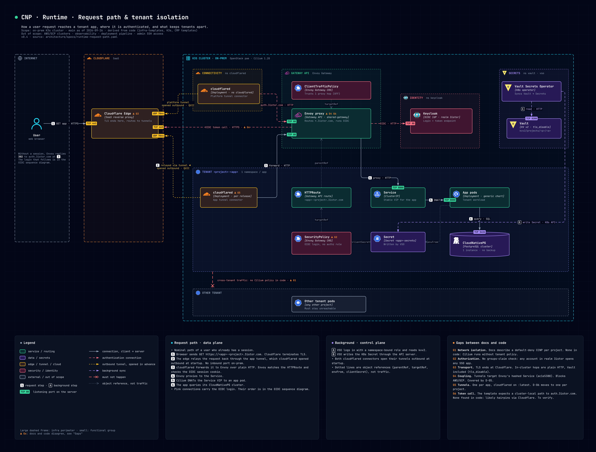

# Noodle 🍜

Take the spaghetti out of a large architecture and keep it clear.

Noodle turns an architecture described as code into readable, presentation-grade
diagrams, and aims further: interactive views, guided tours, visual PR diffs, discovery
from real clusters, live overlays, and a model AI agents can query.
See [the vision](docs/VISION.md).



## Status

**Contracts `v1alpha1`.** A system is a model (what exists), views (what each diagram
shows) and layouts (where a topology is drawn), rendered to draw.io in a dark or light
theme. Five view types: topology, sequence, landscape (tech stack), catalog (service
catalogue) and matrix (who may act on what, before and after a plan). noodle refuses to emit a diagram whose lines cross boxes, whose labels
collide, or whose arrows break the connection semantics. Next: static discovery from
Kubernetes manifests ([roadmap](docs/ROADMAP.md)).

## Install

noodle is one binary, `noodle`, plus a skill and three subagents that teach an AI agent to
use it. Claude Code gets both from a plugin. OpenCode and Codex get the binary, then
`noodle setup` writes the skill and the agents where they look.

### Claude Code

```
/plugin marketplace add TheGostsniperfr/Noodle
/plugin install noodle@noodle
```

Then enable auto-update once, under **Marketplaces** in `/plugin`, to follow `main`.
The plugin puts `noodle` on the PATH. On first use it builds itself from the plugin's
sources with Go or with Nix, or downloads a release binary when neither is installed;
a `noodle` already on the PATH wins. PNG and SVG exports also need
[draw.io desktop](https://www.drawio.com/) (`drawio`).

To offer it to everyone working in a repository, run once there and commit the result:

```bash
claude plugin marketplace add TheGostsniperfr/Noodle --scope project
```

### OpenCode

Install the `noodle` binary (see Nix below, or take an archive from the
[releases](https://github.com/TheGostsniperfr/Noodle/releases)), then in your repository:

```bash
noodle setup opencode -project
```

This writes the `noodle-diagram` skill to `.agents/skills/` and the subagents to
`.opencode/agents/`. Use `-user` instead to install for every project, under
`~/.agents/skills/` and `~/.config/opencode/agents/`. Rerunning it changes nothing, and it
never overwrites a file it did not write.

### Codex

Install the `noodle` binary as above, then in your repository:

```bash
noodle setup codex -project
```

This writes the skill to `.agents/skills/` and one TOML file per subagent to
`.codex/agents/`. `-user` writes under `~/.agents/skills/` and `~/.codex/agents/`.

### Nix

```nix
inputs.noodle.url = "github:TheGostsniperfr/Noodle";
# then: home.packages = [ inputs.noodle.packages.${pkgs.system}.default ];
```

or just `nix run github:TheGostsniperfr/Noodle -- -list-icons`.

## Usage

```bash
noodle render architecture/platform -view runtime                          # check and lint only
noodle render architecture/platform -view runtime -theme dark -o out.drawio  # then render
noodle render architecture/platform -view runtime -icons .noodle/icons -slide  # project icons, drawing only
noodle migrate old-spec.yaml architecture/platform                        # a v0 single file, once
helm template my-release chart/ | noodle discover k8s - -o architecture/platform/discovered/k8s-helm.yaml
noodle -list-icons
drawio -x -f png -s 2 --border 20 -o out.png out.drawio
```

The format is in [the skill reference](skills/noodle-diagram/reference.md).

## Examples

| System | Shows |
|---|---|
| [`tutorial`](examples/tutorial) | the system of the tutorial: a user, an API and a database in two zones |
| [`cnp-runtime`](examples/cnp-runtime) | one model, two views: the runtime topology and the OIDC login sequence |
| [`sequence-basics`](examples/sequence-basics) | every sequence step kind: messages, a relay against a tunnel, a note, replies |
| [`landscape`](examples/landscape) | a tech stack: bands, a side column, a pipeline, planned items with a target |
| [`catalog`](examples/catalog) | a service catalogue built from the model's offerings |
| [`topology-diff`](examples/topology-diff) | a proposal drawn as a diff: what it adds and removes over the dimmed platform, next to the reference view of the same model |
| [`messaging`](examples/messaging) | a message broker: queues drawn as pipes, bindings and a dead-letter link drawn as broker routes |
| [`cnp-access`](examples/cnp-access) | an access matrix from memberships and grants: what a segregation plan changes, phase by phase |
| [`platform-regression`](examples/platform-regression) | three large topologies from a real platform, kept as regression fixtures |

## Docs

- [User guide](docs/guide/tutorial.md): a tutorial from a first system to a PNG, how-to pages, an explanation of model, view, layout and fragment, and the [CLI reference](docs/guide/cli.md)
- [Vision](docs/VISION.md): the problem, principles and capability levels L0 to L6
- [Architecture](docs/ARCHITECTURE.md): modules, contracts, interfaces, storage and security
- [Progress](docs/PROGRESS.md): where the work stands and where the next session starts
- [Project board](https://github.com/users/TheGostsniperfr/projects/5): the backlog, one issue per item
- [Roadmap](docs/ROADMAP.md): phases and their exit criteria, checked in [features.json](docs/features.json)
- [Specs](specs/): one spec per piece of work, written before the code
- [Decisions](docs/adr/README.md): ADRs
- [Inspirations](docs/INSPIRATIONS.md): IcePanel, Ilograph, LikeC4 and others, and what we borrow
- [Diagram skill](skills/noodle-diagram/SKILL.md): the conventions an AI agent follows to write diagrams

## Contributing

- [Contributing](CONTRIBUTING.md): the workflow, the checks and how a pull request is read
- [Security policy](SECURITY.md): report a vulnerability privately; an architecture map is sensitive
- [Code of conduct](CODE_OF_CONDUCT.md): Contributor Covenant 2.1

Noodle is licensed under Apache-2.0 (see [LICENSE](LICENSE) and [NOTICE](NOTICE)); the logos
in `assets/icons/` stay trademarks of their owners ([attribution](assets/icons/ATTRIBUTION.md)).

## Development

```bash
nix develop
make init                # vet, test, lint the examples, check specs and features, show next features
```

Dependencies are vendored (`go mod vendor`) so the plugin can build offline. Run
`go mod vendor` after changing `go.mod`.
