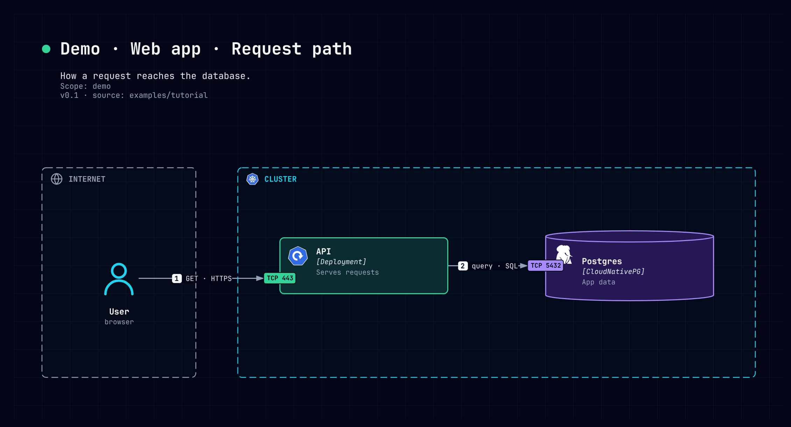

# Tutorial: your first system to a PNG

You will describe a small web application as code, render it, and export a PNG. It takes
about ten minutes. The finished system is in [`examples/tutorial`](../../examples/tutorial).

## 1. Get noodle and draw.io

On NixOS or any machine with Nix, run noodle without installing it:

```bash
nix run github:TheGostsniperfr/Noodle -- version
```

Without Nix, take the archive for your platform from the
[releases](https://github.com/TheGostsniperfr/Noodle/releases) and put `noodle` on your PATH.
Check it with `noodle version`.

PNG export needs [draw.io desktop](https://www.drawio.com/), which provides the `drawio`
command. noodle itself writes `.drawio` files and does not need it.

## 2. Describe what exists

A system is a directory. Create `architecture/demo/model.yaml`:

```yaml
apiVersion: noodle/v1alpha1
kind: Model
elements:
  - {id: z-internet, kind: region, color: slate, icon: globe, title: INTERNET}
  - {id: z-cluster, kind: region, color: cyan, icon: kubernetes, title: CLUSTER}
  - {id: user, kind: frontend, parent: z-internet, shape: actor, icon: user, title: User, desc: browser}
  - {id: api, kind: backend, parent: z-cluster, icon: k8s-deploy, title: API, tech: "[Deployment]", desc: Serves requests,
     ports: [{name: https, protocol: TCP, port: 443}]}
  - {id: db, kind: database, parent: z-cluster, shape: cylinder, icon: cnpg, title: Postgres, tech: "[CloudNativePG]",
     desc: App data, ports: [{name: pg, protocol: TCP, port: 5432}]}
connections:
  - {id: c-user-api, from: user, to: api, kind: flow, port: https, protocol: HTTPS, verb: GET}
  - {id: c-api-db, from: api, to: db, kind: flow, port: pg, protocol: SQL, verb: query}
```

Two zones, three components, two connections. A connection goes from the side that opens
it to the side that listens, and `port` names a port of the listening side.
Icon names come from `noodle -list-icons`.

## 3. Choose what one diagram shows

Create `architecture/demo/views/request.yaml`. A view answers one question:

```yaml
apiVersion: noodle/v1alpha1
kind: View
type: topology
title: Demo · Web app · Request path
subtitle: How a request reaches the database.
meta: ["Scope: demo", "v0.1 · source: architecture/demo"]
steps: [c-user-api, c-api-db]
```

`steps` numbers the connections `[1]` and `[2]` in time order.

## 4. Place it

A topology view needs a layout with the same file name, where you say where each box goes.
Create `architecture/demo/layouts/request.yaml`:

```yaml
apiVersion: noodle/v1alpha1
kind: Layout
canvas: {width: 1100, height: 580}
elements:
  z-internet: {x: 40, y: 220, w: 220, h: 300}
  z-cluster: {x: 320, y: 220, w: 740, h: 300}
  user: {x: 82, y: 130, w: 56, h: 56}
  api: {x: 60, y: 100, w: 240, h: 80}
  db: {x: 440, y: 90, w: 240, h: 100}
edges:
  c-user-api: {from: user.right, to: api.left}
  c-api-db: {from: api.right, to: db.left}
```

Boxes inside a zone are placed relative to that zone. Edges leave from a side of the
client and enter a side of the server.

## 5. Check, render, export

```bash
noodle render architecture/demo -view request
```

With no `-o`, noodle only checks the system and lints the drawing. It prints nothing when
all is well. A box too narrow for its text, or a line crossing a box, is reported here and
no file is written: fix the layout, never the rule.

```bash
noodle render architecture/demo -view request -theme dark -o request.dark.drawio
drawio -x -f png -s 2 --border 20 -o request.dark.png request.dark.drawio
```

Open the PNG and look at it. The lint catches geometry, not taste.



Repeat with `-theme light` for a light variant.

## Next

- Read the [explanation](explanation.md) to see why the files are split this way.
- Look up any flag in the [CLI reference](cli.md).
- Draw a system you already run: [discover it from manifests](howto-discover.md).
